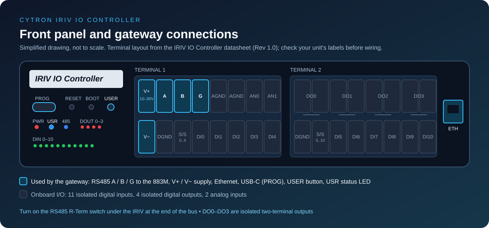
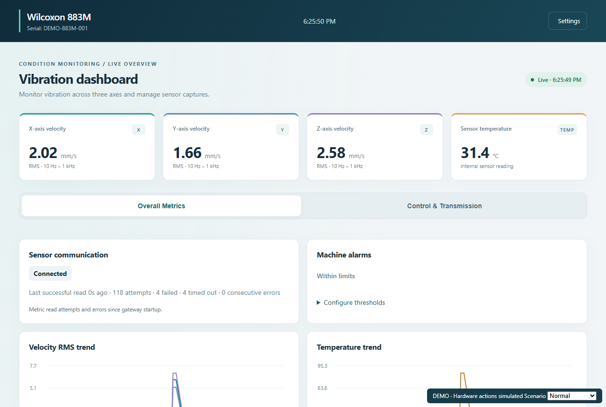

# ILA210 and 883M Library

**Firmware downloads for Wilcoxon ILA210 and 883M sensor gateways on the Cytron IRIV IO Controller.**

Choose the firmware for your sensor. Each sensor has its own IOC image. This repository is a firmware download library; reusable Arduino library source lives in the source project.

The gateways read sensor data over Modbus RTU and provide Ethernet integration, Modbus TCP, MQTT and browser interfaces.

[883M main release](https://github.com/dineshpalsingh1989/ILA210-and-883M-Library/releases/tag/v4.10.0-beta.3) | [ILA210 downloads](https://github.com/dineshpalsingh1989/ILA210-and-883M-Library/releases/tag/ila210-v4.11.5-beta.2) | [Report a problem](https://github.com/dineshpalsingh1989/ILA210-and-883M-Library/issues) | [Source project](https://github.com/dineshpalsingh1989/Wilcoxon-883M_RTU-to-TCP-and-MQTT)



*Controller illustration, not a photograph or a wiring substitute. Check your unit's terminal labels and the board and sensor manuals before connecting equipment.*

## 883M gateway features

| Feature | Purpose |
| --- | --- |
| Modbus RTU | Read the Wilcoxon 883M over RS485 |
| Modbus TCP | Expose cached sensor readings to network clients |
| MQTT | Publish sensor information to a broker |
| Browser dashboard | View sensor status, vibration metrics and trends |
| Capture controls | Start and inspect sensor captures |
| Device settings | Configure network, sensor and integration settings |
| Manual firmware upload | Install a compatible BIN image through the gateway |

## 883M dashboard preview



*Shared gateway dashboard rendered by the ESP32 hardware-free demo with simulated readings. This illustrates the interface; it is not a screenshot from the IRIV controller and does not establish hardware validation.*

## Choose your IOC firmware

| Sensor | IOC firmware | Release status |
| --- | --- | --- |
| Wilcoxon 883M | [883M downloads](https://github.com/dineshpalsingh1989/ILA210-and-883M-Library/releases/tag/v4.10.0-beta.3) | Main release; retained build identifier `4.10.0-beta.3` |
| Wilcoxon ILA210 | [ILA210 downloads](https://github.com/dineshpalsingh1989/ILA210-and-883M-Library/releases/tag/ila210-v4.11.5-beta.2) | Source release `4.11.5-beta.2` (prerelease) |

Both target the Cytron IRIV IO Controller (RP2350 + W5500). Their sensor protocols and firmware are separate; select the matching sensor image.

## 883M downloads

This repository distributes the **main firmware release** for the **Cytron IRIV IO Controller (RP2350 + W5500)** and **Wilcoxon 883M** sensor.

| Download | When to use it |
| --- | --- |
| [IRIV-883M-beta3.uf2](https://github.com/dineshpalsingh1989/ILA210-and-883M-Library/releases/download/v4.10.0-beta.3/IRIV-883M-beta3.uf2) | Install through the board's USB bootloader |
| [IRIV-883M-beta3.bin](https://github.com/dineshpalsingh1989/ILA210-and-883M-Library/releases/download/v4.10.0-beta.3/IRIV-883M-beta3.bin) | Upload through an existing compatible gateway |
| [SHA256SUMS-beta3.txt](https://github.com/dineshpalsingh1989/ILA210-and-883M-Library/releases/download/v4.10.0-beta.3/SHA256SUMS-beta3.txt) | Verify downloaded firmware files |

The release is designated as the main release. The unchanged binaries, filenames and release tag retain the internal build identifier `4.10.0-beta.3`.

## ILA210 downloads

The ILA210 IOC firmware is copied from the source project's `v4.11.5-beta.2` release. Both files were checked against the source release SHA-256 digests, then verified again after upload. No rebuild or version change was performed.

| Download | When to use it |
| --- | --- |
| [firmware-ila210-cytron_iriv_io_controller.bin](https://github.com/dineshpalsingh1989/ILA210-and-883M-Library/releases/download/ila210-v4.11.5-beta.2/firmware-ila210-cytron_iriv_io_controller.bin) | Manual update of a compatible ILA210 gateway |
| [firmware-ila210-cytron_iriv_io_controller.uf2](https://github.com/dineshpalsingh1989/ILA210-and-883M-Library/releases/download/ila210-v4.11.5-beta.2/firmware-ila210-cytron_iriv_io_controller.uf2) | USB bootloader installation |
| [SHA256SUMS-ILA210.txt](https://github.com/dineshpalsingh1989/ILA210-and-883M-Library/releases/download/ila210-v4.11.5-beta.2/SHA256SUMS-ILA210.txt) | Verify the ILA210 downloads |

ILA210 sensor discovery, configuration and diagnostics are available at `/sensor_setup`. See the [ILA210 IOC guide](https://github.com/dineshpalsingh1989/Wilcoxon-883M_RTU-to-TCP-and-MQTT/tree/main/ILA210/IRIV%20IOC). Physical IOC and sensor validation remain pending.

## Before installation

- Confirm the controller and sensor match your selected image. Choose ILA210 or 883M explicitly; ESP32 boards require separate firmware.
- Back up important gateway settings.
- Use the board's documented power supply, USB connection and bootloader procedure.
- Review the [883M wiring guide](https://github.com/dineshpalsingh1989/Wilcoxon-883M_RTU-to-TCP-and-MQTT/blob/main/docs/wiring.md) and the bundled sensor manual in the source project.

## Install using USB

1. Download the UF2 image and checksum file above.
2. Verify the downloaded file's SHA-256 checksum.
3. Follow the Cytron board documentation to enter USB bootloader mode.
4. Copy the `.uf2` image to the board's bootloader volume and keep power connected during installation.
5. Allow the controller to restart, then reconnect to the gateway and check its firmware version and settings.

## Update an existing compatible gateway

1. Download the BIN image and verify its checksum.
2. Open the existing gateway for the same sensor in your browser. When changing sensor families, use the USB installation method and the target project guide.
3. Open its manual firmware upload control (Device Diagnostics on the 883M gateway) and select the matching `.bin` file.
4. Wait for installation and restart to finish while keeping power connected.
5. Reopen the gateway and check the firmware version, sensor status and saved settings.

## Verify a download on Windows

From PowerShell in the download folder:

```powershell
Get-FileHash .\IRIV-883M-beta3.uf2 -Algorithm SHA256
Get-FileHash .\IRIV-883M-beta3.bin -Algorithm SHA256

# For the ILA210 firmware:
Get-FileHash .\firmware-ila210-cytron_iriv_io_controller.uf2 -Algorithm SHA256
Get-FileHash .\firmware-ila210-cytron_iriv_io_controller.bin -Algorithm SHA256
```

Compare each hash with the matching filename in `SHA256SUMS-beta3.txt` (883M) or `SHA256SUMS-ILA210.txt` (ILA210).

## 883M first connection

Connect Ethernet to a network with DHCP and open the controller's assigned address in a browser. Without DHCP, the project's documented fallback address is `192.168.4.1`; use a compatible local network configuration to reach it.

Configure the sensor connection and your Modbus TCP or MQTT integration in the gateway settings. Use plain MQTT on a trusted network or through a local broker: MQTT over TLS is not supported for bench use in the current IRIV project guidance.

## Build and validation status

The supplied files are existing prepared binaries, verified against their SHA-256 checksums. They were not rebuilt for this repository publication.

Hardware validation remains pending. The watchdog is disabled in the supplied 883M build, so a hang may require a manual reset or power cycle. Compilation and simulated browser tests do not establish real controller behavior. Boot, I/O, sensor communication, networking, settings persistence and update recovery still require hardware verification.

## Help and source code

For an issue, include the controller model, firmware version shown by the device, installation method, symptoms and relevant diagnostics. Remove credentials and other private information before sharing logs.

- [Open an issue](https://github.com/dineshpalsingh1989/ILA210-and-883M-Library/issues)
- [Gateway source repository](https://github.com/dineshpalsingh1989/Wilcoxon-883M_RTU-to-TCP-and-MQTT)
- [883M IRIV project guide](https://github.com/dineshpalsingh1989/Wilcoxon-883M_RTU-to-TCP-and-MQTT/tree/main/IRIV%20IOC)
